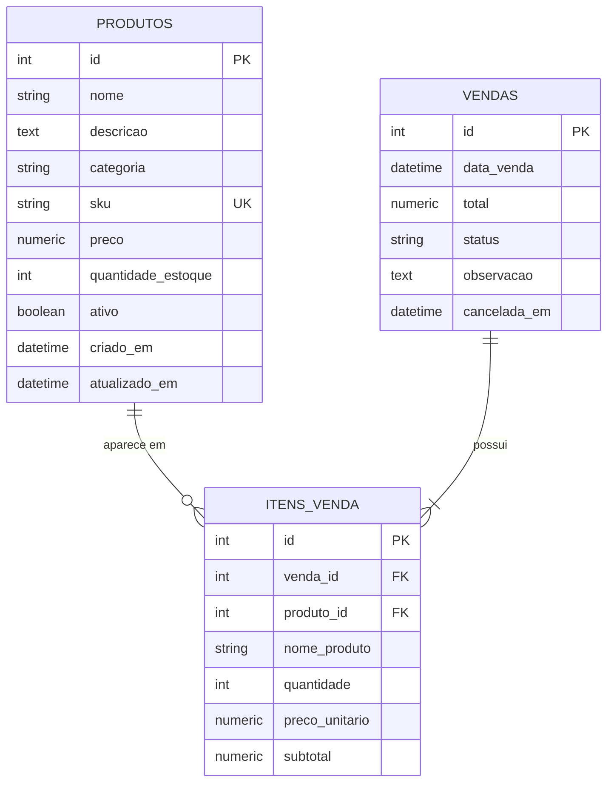

# API de Gestão de Produtos e Vendas

API REST desenvolvida com **Python + FastAPI** para cadastro de produtos, registro de vendas, histórico e controle automático de estoque. O banco de dados é criado automaticamente com **SQLAlchemy + SQLite**, e todas as rotas são documentadas no **Swagger**.


---

## Objetivos atendidos

| Requisito do projeto | Como foi implementado |
|---|---|
| API web com Python e FastAPI | Aplicação em `app/main.py`, com rotas versionadas em `/api/v1` |
| Banco para produtos e vendas | SQLite com modelos ORM `Produto`, `Venda` e `ItemVenda` |
| Cadastro e consulta de produtos | `POST /produtos`, `GET /produtos` e `GET /produtos/{id}` |
| Alteração e exclusão de produtos | `PATCH /produtos/{id}` e `DELETE /produtos/{id}` |
| Registro e histórico de vendas | `POST /vendas` e `GET /vendas` com filtros e paginação |
| Atualização do estoque após venda | Baixa automática e transacional ao registrar a venda |
| Bloqueio de venda sem estoque | Validação antes de qualquer alteração, retornando HTTP 409 |
| Documentação Swagger | Swagger em `/docs`, ReDoc em `/redoc` e OpenAPI em `/openapi.json` |
| Testes com Postman/Insomnia | Coleção com 23 requisições em `docs/postman_collection.json` |
| Organização e Git/GitHub | Estrutura em camadas, README, testes automatizados e histórico de commits |

### Funcionalidades extras

- Cancelamento de venda com **estorno automático** ao estoque.
- Exclusão lógica de produtos que já possuem vendas, preservando o histórico.
- Histórico de vendas com **preço e nome do produto no momento da compra**.
- Busca textual, filtros, paginação e ordenação.
- Testes automatizados com **pytest** (27 testes), além dos testes manuais no Postman.
- Seed opcional com produtos de exemplo.

---

## Tecnologias

- **Python 3.12**
- **FastAPI** — rotas, validação e documentação OpenAPI
- **Pydantic v2** — schemas de entrada e saída
- **SQLAlchemy 2** — ORM e transações
- **SQLite** — banco de dados local (sem necessidade de instalação de servidor)
- **Uvicorn** — servidor ASGI
- **Pytest + TestClient** — testes automatizados
- **Postman** — testes manuais e de integração

---

## Estrutura do projeto

```text
trabalho/
├── app/
│   ├── main.py                  # Criação do FastAPI, Swagger, CORS e rotas raiz
│   ├── database.py              # Engine, sessão e criação das tabelas
│   ├── dependencies.py          # Dependência de sessão do banco
│   ├── seed.py                  # Produtos de exemplo
│   ├── core/
│   │   ├── config.py            # Configurações via .env
│   │   └── exceptions.py        # Exceções de negócio
│   ├── models/
│   │   ├── produto.py           # Tabela produtos
│   │   └── venda.py             # Tabelas vendas e itens_venda
│   ├── schemas/
│   │   ├── comum.py             # Erros, mensagens e paginação
│   │   ├── produto.py           # Schemas de produto
│   │   └── venda.py             # Schemas de venda
│   ├── services/
│   │   ├── produto_service.py   # Regras de produto
│   │   └── venda_service.py     # Regras de venda e estoque
│   └── routers/
│       ├── produtos.py          # Endpoints de produtos
│       └── vendas.py            # Endpoints de vendas
├── tests/
│   ├── conftest.py              # Banco isolado em memória
│   ├── test_produtos.py         # 16 testes de produtos
│   └── test_vendas.py           # 11 testes de vendas/estoque
├── docs/
│   ├── postman_collection.json  # Coleção pronta para importar no Postman
│   ├── TESTES.md                # Plano e evidências dos testes
│   └── roteiro_apresentacao.md  # Roteiro para demonstrar o projeto
├── data/                        # Banco SQLite local (gerado automaticamente)
├── requirements.txt
├── requirements-dev.txt
├── .env.example
├── pytest.ini
└── README.md
```

### Arquitetura em camadas

```text
Cliente (Swagger/Postman)
        │ HTTP
        ▼
Routers ── validação ──► Services ── regras de negócio ──► Models/SQLAlchemy ──► SQLite
        ◄── schemas ──────┘
```

Os routers cuidam de HTTP, os services concentram as regras de negócio e os models representam o banco. Essa separação facilita manutenção e testes.

---

## Como executar

### 1. Pré-requisitos

- Python 3.11 ou superior (testado com 3.12.10)
- Git (opcional, para versionamento)
- Postman ou Insomnia (opcional, para os testes manuais)

### 2. Criar o ambiente virtual e instalar dependências

**Windows (PowerShell):**

```powershell
cd caminho/do/projeto
python -m venv .venv
.\.venv\Scripts\Activate.ps1
python -m pip install --upgrade pip
pip install -r requirements-dev.txt
```

Se o PowerShell bloquear a ativação:

```powershell
Set-ExecutionPolicy -Scope Process -ExecutionPolicy Bypass
```

**Linux/macOS:**

```bash
cd caminho/do/projeto
python3 -m venv .venv
source .venv/bin/activate
python -m pip install --upgrade pip
pip install -r requirements-dev.txt
```

> Para rodar apenas a API, `requirements.txt` já contém as dependências de produção.
> `requirements-dev.txt` adiciona pytest e httpx para os testes.

### 3. Configuração (opcional)

```powershell
Copy-Item .env.example .env
```

O arquivo `.env` é opcional. Sem ele, a aplicação usa:

```env
DATABASE_URL=sqlite:///./data/vendas.db
CORS_ORIGINS=*
```

### 4. Popular o banco com dados de exemplo (opcional)

```powershell
python -m app.seed
```

### 5. Iniciar a API

```powershell
python -m uvicorn app.main:app --reload
```

Acesse:

- **Swagger:** http://127.0.0.1:8000/docs
- **ReDoc:** http://127.0.0.1:8000/redoc
- **OpenAPI JSON:** http://127.0.0.1:8000/openapi.json
- **Health check:** http://127.0.0.1:8000/health

O banco `data/vendas.db` e as tabelas são criados automaticamente na primeira inicialização.

---

## Endpoints

### Sistema

| Método | Rota | Descrição |
|---|---|---|
| GET | `/` | Informações da API e links da documentação |
| GET | `/health` | Verifica API e conexão com o banco |
| GET | `/docs` | Interface interativa do Swagger |
| GET | `/redoc` | Documentação ReDoc |

### Produtos

| Método | Rota | Descrição | Sucessos | Erros |
|---|---|---|---|---|
| POST | `/api/v1/produtos` | Cadastra um produto | 201 | 409, 422 |
| GET | `/api/v1/produtos` | Lista, busca e filtra produtos | 200 | — |
| GET | `/api/v1/produtos/{id}` | Consulta produto por ID | 200 | 404 |
| PATCH | `/api/v1/produtos/{id}` | Atualiza parcialmente um produto | 200 | 404, 409, 422 |
| DELETE | `/api/v1/produtos/{id}` | Exclui ou desativa um produto | 204 | 404 |

**Parâmetros de listagem:** `skip`, `limit`, `busca`, `categoria`, `ativo`.

### Vendas

| Método | Rota | Descrição | Sucessos | Erros |
|---|---|---|---|---|
| POST | `/api/v1/vendas` | Registra venda e baixa o estoque | 201 | 404, 409, 422 |
| GET | `/api/v1/vendas` | Consulta histórico com filtros | 200 | — |
| GET | `/api/v1/vendas/{id}` | Consulta uma venda e seus itens | 200 | 404 |
| PATCH | `/api/v1/vendas/{id}/cancelar` | Cancela a venda e estorna o estoque | 200 | 404, 409 |

**Parâmetros do histórico:** `skip`, `limit`, `status` (`CONCLUIDA`/`CANCELADA`), `data_inicio`, `data_fim` (ISO 8601).

### Códigos de erro

| Código | Significado |
|---|---|
| 400 | Requisição inválida |
| 404 | Produto, venda ou recurso não encontrado |
| 409 | Regra de negócio violada (SKU duplicado, estoque insuficiente, produto inativo, venda já cancelada) |
| 422 | Validação de campos (preço negativo, quantidade zero, campos obrigatórios etc.) |

---

## Exemplos de uso

### Cadastrar produto

```http
POST /api/v1/produtos
Content-Type: application/json
```

```json
{
  "nome": "Teclado Mecânico RGB",
  "descricao": "Teclado ABNT2 com switches azuis e iluminação RGB.",
  "categoria": "Periféricos",
  "sku": "TEC-RGB-001",
  "preco": 249.90,
  "quantidade_estoque": 25
}
```

Resposta `201 Created`:

```json
{
  "id": 1,
  "nome": "Teclado Mecânico RGB",
  "descricao": "Teclado ABNT2 com switches azuis e iluminação RGB.",
  "categoria": "Periféricos",
  "sku": "TEC-RGB-001",
  "preco": "249.90",
  "quantidade_estoque": 25,
  "ativo": true,
  "criado_em": "2026-01-15T13:30:00",
  "atualizado_em": "2026-01-15T13:30:00"
}
```

### Registrar venda

```http
POST /api/v1/vendas
Content-Type: application/json
```

```json
{
  "itens": [
    { "produto_id": 1, "quantidade": 2 }
  ],
  "observacao": "Venda realizada no balcão."
}
```

Resposta `201 Created`:

```json
{
  "id": 1,
  "data_venda": "2026-01-15T14:00:00",
  "total": "499.80",
  "status": "CONCLUIDA",
  "observacao": "Venda realizada no balcão.",
  "cancelada_em": null,
  "itens": [
    {
      "id": 1,
      "produto_id": 1,
      "nome_produto": "Teclado Mecânico RGB",
      "quantidade": 2,
      "preco_unitario": "249.90",
      "subtotal": "499.80"
    }
  ]
}
```

Após a venda, `GET /api/v1/produtos/1` retorna `"quantidade_estoque": 23`.

### Venda sem estoque

```json
{
  "itens": [
    { "produto_id": 1, "quantidade": 999 }
  ]
}
```

Resposta `409 Conflict`:

```json
{
  "detail": "Estoque insuficiente para 'Teclado Mecânico RGB' (SKU TEC-RGB-001): disponível 23, solicitado 999."
}
```

### Consultar histórico com filtros

```http
GET /api/v1/vendas?status=CONCLUIDA&data_inicio=2026-01-01T00:00:00&limit=20
```

---

## Regras de negócio

1. **SKU único:** não é permitido cadastrar dois produtos com o mesmo SKU, inclusive com diferença de maiúsculas/minúsculas. O SKU é salvo em maiúsculas.
2. **Validação de produto:** nome e categoria obrigatórios; preço maior que zero; estoque maior ou igual a zero.
3. **Venda transacional:** todos os produtos e estoques são validados antes de qualquer alteração. Se um item falhar, a venda inteira é rejeitada e nenhum estoque é debitado.
4. **Estoque suficiente:** a venda é bloqueada com HTTP 409 quando a quantidade solicitada excede o estoque.
5. **Itens repetidos:** se o mesmo produto aparecer mais de uma vez no payload, as quantidades são somadas antes da validação e da baixa.
6. **Produto inativo:** não pode ser vendido, mas permanece consultável no histórico.
7. **Preço histórico:** o preço e o nome do produto são copiados para o item da venda. Alterações futuras no cadastro não mudam vendas antigas.
8. **Cancelamento:** devolve os itens ao estoque e só pode ocorrer uma vez por venda.
9. **Exclusão:**
   - produto **sem vendas** → exclusão física (`DELETE`);
   - produto **com vendas** → desativação lógica (`ativo = false`), preservando o histórico.
10. **Datas:** armazenadas em UTC, sem informação de fuso no SQLite; os filtros do histórico são normalizados para UTC.

---

## Banco de dados



O banco padrão é `data/vendas.db`. Para recriá-lo do zero, pare a API, apague o arquivo e inicie novamente:

```powershell
Remove-Item .\data\vendas.db
python -m app.seed
python -m uvicorn app.main:app --reload
```

As tabelas são criadas automaticamente pelo `lifespan` da aplicação (`Base.metadata.create_all`).

---

## Testes

### Testes automatizados (pytest)

```powershell
python -m pytest -v
```

Resultado esperado: **27 testes aprovados**.

As saídas reais das execuções estão salvas em:

- [`docs/evidencias/pytest.txt`](docs/evidencias/pytest.txt) — 27 testes aprovados.
- [`docs/evidencias/newman.txt`](docs/evidencias/newman.txt) — 23 requisições Postman e 35 asserções aprovadas.

Cobertura dos cenários:

- cadastro, normalização de SKU, duplicidade e validações;
- busca, filtro por categoria, paginação e consulta por ID;
- atualização parcial e conflito de SKU;
- exclusão física e exclusão lógica;
- venda com um e vários produtos, cálculo de total e baixa de estoque;
- agrupamento de itens repetidos;
- bloqueio por estoque insuficiente, produto inativo e produto inexistente;
- atomicidade da venda com múltiplos itens;
- histórico, filtros por status/datas e detalhe da venda;
- cancelamento, estorno e bloqueio de cancelamento duplicado;
- preservação do preço histórico;
- saúde da API e disponibilidade do Swagger.

### Testes manuais no Postman

1. Inicie a API: `python -m uvicorn app.main:app --reload`.
2. Abra o Postman → **Import** → selecione `docs/postman_collection.json`.
3. Confirme a variável `base_url` da coleção (`http://127.0.0.1:8000`).
4. Clique na coleção → **Run** → **Run API de Gestão de Produtos e Vendas**.
5. Execute as 4 pastas na ordem apresentada. A coleção possui **23 requisições** e salva automaticamente os IDs de produto e venda.

Os scripts de teste do Postman verificam status HTTP, corpo, cálculo de total, baixa/estorno de estoque, códigos 409 esperados e exclusão lógica/física. O passo a passo completo e a matriz de testes estão em [`docs/TESTES.md`](docs/TESTES.md).

### Testes rápidos via Swagger

Acesse `/docs`, clique em **Try it out**, execute `POST /api/v1/produtos` e depois `POST /api/v1/vendas`. Use o ID retornado no cadastro para registrar a venda e consulte o estoque atualizado.

---

## Versionamento com Git/GitHub

O projeto foi organizado em commits que representam a evolução do desenvolvimento (estrutura e banco, CRUD de produtos, vendas/estoque, testes e documentação).

Para publicar no GitHub:

```powershell
git remote add origin https://github.com/<seu-usuario>/<nome-do-repositorio>.git
git branch -M main
git push -u origin main
```

Para conferir o histórico:

```powershell
git log --oneline --decorate
```

Sugestão de fluxo para futuras alterações:

```powershell
git checkout -b feature/nome-da-melhoria
# implementar e testar
git add .
git commit -m "feat: descreve a melhoria"
git push -u origin feature/nome-da-melhoria
```

---

## Possíveis problemas

| Problema | Solução |
|---|---|
| `python` não é reconhecido | Reinstale o Python marcando **Add Python to PATH** ou reabra o terminal após a instalação |
| Porta 8000 ocupada | `python -m uvicorn app.main:app --reload --port 8001` |
| Erro de permissão ao ativar a venv | `Set-ExecutionPolicy -Scope Process -ExecutionPolicy Bypass` |
| Banco em estado inconsistente | Pare a API e apague `data/vendas.db`; as tabelas serão recriadas |
| Swagger não abre | Confirme que a API está rodando e acesse `http://127.0.0.1:8000/docs` |
| Testes não encontram o módulo `app` | Execute o pytest a partir da raiz do projeto (`python -m pytest`) |

---

## Melhorias futuras

- Autenticação e autorização com JWT.
- Migrações de banco com Alembic.
- Relatórios de vendas e faturamento por período.
- Cadastro de clientes e formas de pagamento.
- Docker e Docker Compose para implantação.
- Testes de carga e cobertura com `pytest-cov`.

---

## Licença

Distribuído para fins acadêmicos. Consulte o arquivo [`LICENSE`](LICENSE).

> Documentação complementar: [`docs/TESTES.md`](docs/TESTES.md) e [`docs/roteiro_apresentacao.md`](docs/roteiro_apresentacao.md).
